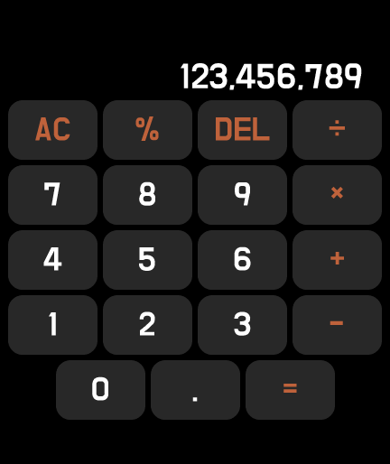

# 레드미워치 계산기 앱

###
###
## 0. 들어가기에 앞서
- 해당 앱을 시계에 설치함으로써 발생하는 기기 오작동 및 모든 불이익에 대해 개발자는 책임을 지지 않습니다.
###
###
## 1. 설치방법
### 1.1. [[다운로드]](https://raw.githubusercontent.com/maga32/mi-facedown-files/main/latest.apk) <= 버튼을 눌러 MiFaceDown 안드로이드용 apk앱을 설치해주세요.

### 1.2. 내정보 탭에서 워치 연동 후 [Face 탭 - 개발자서버 - 자신의 모델] 선택후 계산기 앱을 누르면 다운로드 후 설치됩니다.

###
###
## 2. 삭제방법
### 2.1. 워치내에서 앱삭제를 제공하는 경우 꾹 눌러 삭제 가능합니다.
### 2.2. 워치내에서 삭제가 불가능한 모델은 [내정보 탭 - 연결기기작업 - 퀵앱선택]을 누르면 삭제 가능합니다.

###
###
## 3. 기타정보
- 위 앱은 샤오미 vela 프레임워크로 개발되었습니다 : https://iot.mi.com/vela/quickapp
